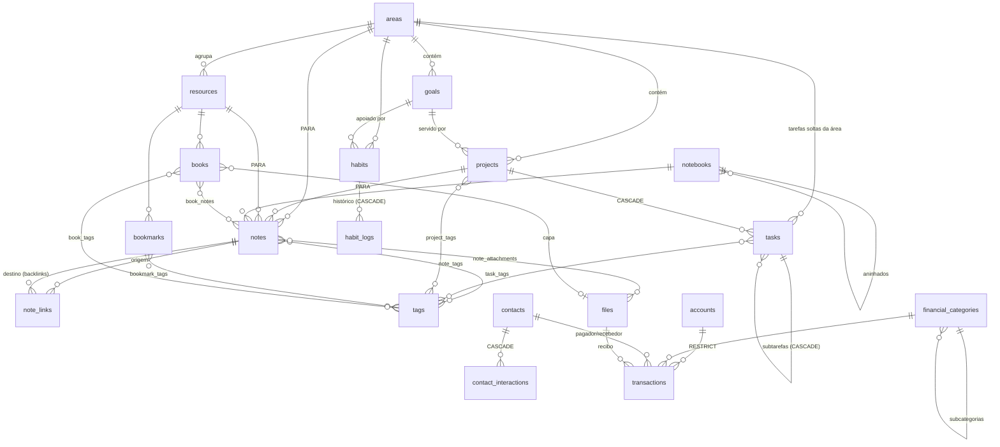

# Banco de dados — schema e relacionamentos

Fonte da verdade: `src/worker/db/schema/*.ts` (Drizzle). O SQL em `migrations/` é **gerado**
(`pnpm db:generate`) e **aplicado** pelo Wrangler (`pnpm db:migrate:local` / `db:migrate:remote`),
que registra o histórico na tabela `d1_migrations`. Nunca altere o schema de produção à mão.

## 1. Convenções

| Regra | Implementação |
|---|---|
| Chave primária | `id TEXT` com **UUIDv7** (ordenável por tempo → inserts sequenciais no B-tree) |
| Timestamps | `created_at`, `updated_at` em ms Unix UTC; default no banco `(cast(unixepoch('subsec')*1000 as integer))`, então até `INSERT` em SQL puro (restore) fica correto |
| Datas de calendário | `TEXT 'YYYY-MM-DD'` + `CHECK` de formato |
| Soft delete | `deleted_at` (lixeira). Exclusão física só ao esvaziar a lixeira |
| Arquivo (PARA Archive) | `archived_at` — inativo mas pesquisável. Diferente de lixeira |
| Enums | `TEXT` + `CHECK (col IN (...))`, valores em `src/shared/enums.ts` (mesma fonte para Zod e UI) |
| Dinheiro | `INTEGER` em **centavos**, com sinal; nunca `REAL` |
| N:N | Tabelas de junção explícitas com PK composta + índice na segunda coluna |
| Integridade | FKs com `ON DELETE` explícito; D1 aplica FKs por padrão (`PRAGMA foreign_keys = 1`, verificado) |
| Ordenação manual (kanban/drag) | `position REAL` (permite inserir entre dois itens sem renumerar) |

### Regra PARA de localização única
Um item vive em **um** lugar do PARA. Garantido por `CHECK` no banco:
* `tasks`: no máximo um de `project_id`, `area_id` (a área de uma tarefa de projeto é derivada do projeto — sem duplicar).
* `notes`: no máximo um de `project_id`, `area_id`, `resource_id`.
* "Archive" não é um lugar, é um estado (`archived_at`).
* `tags` e `notebooks` são organizações **transversais**, independentes do PARA.

## 2. Diagrama entidade-relacionamento



Tabelas independentes (sem FK, de propósito): `inbox_items`, `journal_entries`, `saved_views`,
`settings`, `audit_logs` (precisa sobreviver à exclusão do que descreve), `backup_runs`.

## 3. Tabelas por módulo

| Módulo | Tabelas |
|---|---|
| Inbox | `inbox_items` |
| PARA | `areas`, `projects`, `tasks`, `goals`, `resources` |
| Hábitos | `habits`, `habit_logs` (único por hábito+dia) |
| Conhecimento | `notes`, `notebooks`, `note_links`, `tags`, `note_tags` |
| Bookmarks / Bookshelf | `bookmarks`, `bookmark_tags`, `books`, `book_tags`, `book_notes` |
| Arquivos | `files` (metadados de objetos do R2 + `sha256`), `note_attachments` |
| Finanças | `accounts`, `financial_categories`, `transactions` |
| Diário | `journal_entries` (1 entrada viva por dia — índice único **parcial** `WHERE deleted_at IS NULL`) |
| CRM | `contacts`, `contact_interactions` |
| Sistema | `saved_views`, `settings`, `audit_logs`, `backup_runs` |

32 tabelas no total. Módulos como Dashboard, Archive, Global Search e Settings são **visões** sobre
essas tabelas — não precisam de tabelas próprias.

## 4. Decisões de modelagem (e por quê)

* **Saldo de conta não é armazenado**: `saldo = opening_balance_cents + Σ amount_cents` (não excluídas).
  Guardar o saldo criaria informação duplicada que pode divergir.
* **Sinal no valor**: `amount_cents < 0` = saída. `CHECK` garante coerência com `kind`
  (`income` > 0, `expense` < 0). Transferência = 2 linhas com o mesmo `transfer_group_id`
  (`CHECK`: transfer ⇔ grupo presente), gravadas atomicamente com `db.batch()` (Fase 5).
* **Moeda na conta**, não na transação: transações herdam a moeda da conta.
* **`accounts` → `transactions` é `RESTRICT`**: impossível apagar fisicamente uma conta com lançamentos.
* **Conteúdo de notas em dois campos**: `content_json` (documento Tiptap, fonte da verdade da edição) e
  `content_text` (texto puro derivado, para FTS/exportação/preview). É uma desnormalização deliberada,
  mantida exclusivamente pelo serviço de notas.
* **Backlinks materializados** em `note_links` (recalculados ao salvar a nota), para consultas O(índice).
* **Inbox sem FK polimórfica**: ao processar, o item vira tarefa/nota e recebe `processed_at`.
  FKs polimórficas (`entity_type` + `entity_id`) quebrariam a integridade referencial.
* **Tags únicas sem diferenciar maiúsculas** (`UNIQUE (name COLLATE NOCASE)`).
* **`contacts.last_contacted_at` não existe**: é `MAX(contact_interactions.occurred_at)`.

## 5. Busca full-text (Fase 4 — migração `0001_search_fts.sql`)

Tabela virtual FTS5 única, alimentada por *triggers* nas tabelas de origem:

```sql
CREATE VIRTUAL TABLE search_index USING fts5(
  entity_type UNINDEXED, entity_id UNINDEXED, title, body,
  tokenize = 'unicode61 remove_diacritics 2'   -- "ação" casa com "acao"
);
-- 24 triggers (AFTER INSERT / AFTER UPDATE OF <colunas relevantes> / AFTER DELETE) em
-- notes, tasks, projects, areas, goals, resources, bookmarks, books. Cada um remove a
-- linha antiga do índice e reinsere se deleted_at IS NULL (arquivados continuam pesquisáveis).
-- Diário e contatos entram na Fase 5.
```

⚠️ Limitação: `wrangler d1 export` **não exporta bancos com tabelas virtuais**. Ver `RISKS.md` (R2) —
a estratégia de backup não depende desse comando.

## 6. Verificação de integridade

O D1 **bloqueia** `PRAGMA integrity_check` (`SQLITE_AUTH`, testado), mas permite:
* `PRAGMA quick_check` → deve retornar `ok`
* `PRAGMA foreign_key_check` → deve retornar zero linhas

Ambos rodam via `POST /api/system/integrity-check` (registrado em `backup_runs` e `audit_logs`)
e na suíte de testes (`tests/worker/schema-integrity.test.ts`).
